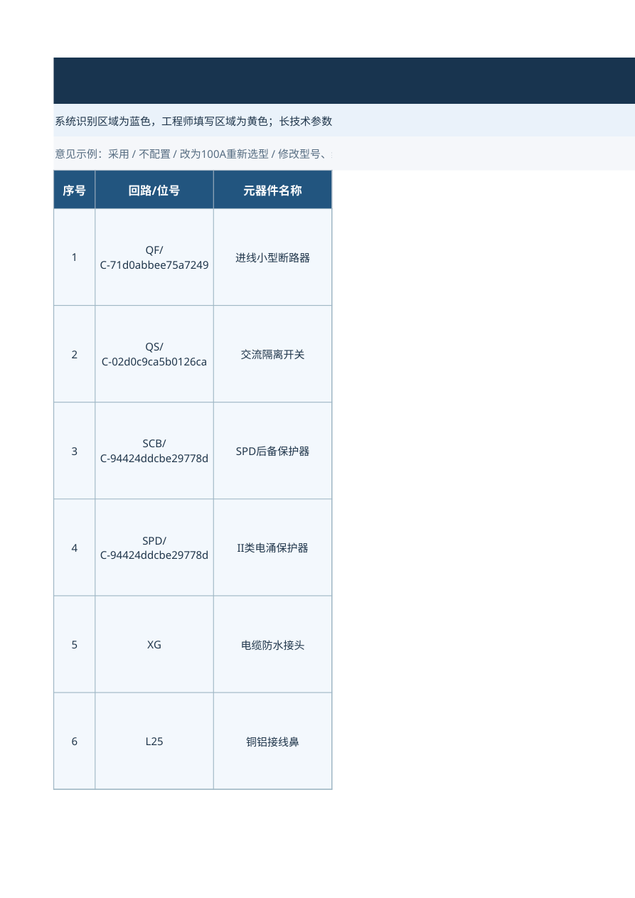
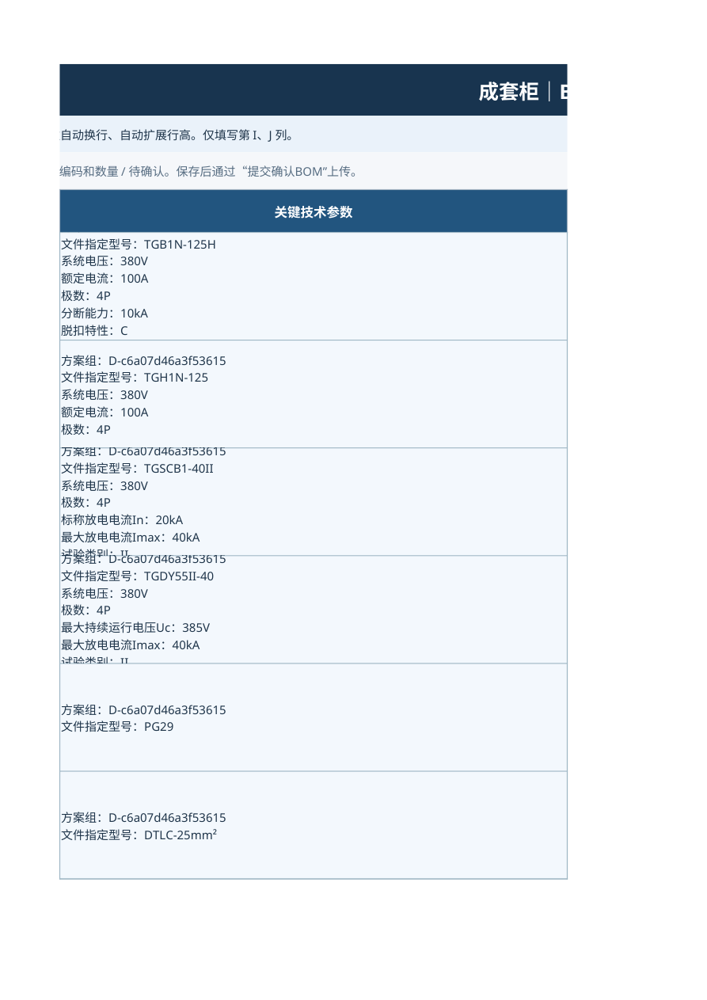

# 产品库、价格库、API、工作流与BOM排版核查

核查日期：2026-10-27。原始上传文件未修改。结论：不能判定为正式落地验收通过；存在已证实的清洗数值错误、检索召回错误和表格排版缺陷。

本次检查依据：上传的50kW协议、CAD文字PDF及本次BOM确认工作簿；已发布产品/价格导入包；仓库API和V18.1 HTTP工作流源码。没有直接登录用户的实时MongoDB或电脑API，因此不以离线数据代替现场全库证明。

## 1. 产品库：结构通过不等于数据内容通过

全量检查已发布的产品JSONL：116,632条；产品编码均为字符串；category和standard_specs为对象；source_attributes和quality_flags为数组；未检测到重复编码或缺失编码/描述。

但清洗函数存在可直接复现的错误：

| 原始value_text | 实际value_num | 问题 |
|---|---:|---|
| AC380V | 80 | 丢失首位3 |
| DC24V | 4 | 丢失首位2 |
| AC230/400V | 30 | 丢失首位且把多额定值当单个数值 |

原因是原解析器使用未锚定的 `(?<![A-Za-z])` 数值匹配，AC/DC后第一个数字被跳过，再从后续数字开始匹配。原始value_text和规格文字仍保留，这些派生字段可以重新解析修复。

全库规则扫描标记67,806个“派生数字与原文完整数字不一致”的疑点，涉及47,063个物料。ACTIVE子集内标记31,352个疑点，涉及24,333个物料。**这些是自动规则的复核范围，不代表这些物料全部无效，也不等同于上游STATUS=无效的47,462条。** 复合型号、范围等需按字段语义复核。

当前YAML大量校验仍使用原始规格文字，因此部分选择可成功；但不能因此认可错误value_num。后续用标准数值字段作过滤或比较时会产生风险。

### 现场MongoDB类型尚需只读核验

Navicat可能把嵌套对象或数组导入成JSON字符串。BOM中出现整段分类JSON，是需要检查的迹象，但尚不能据此确认全库均如此。

运行配套 `audit_tools/check_live_field_types.js` 可以统计实际BSON类型；期望material_code为string、category/standard_specs为object、source_attributes/quality_flags为array。必须区分已发布文件与实际入库结果。

## 2. 价格库：有金额，不等于有真实核价依据

69,170条记录均有正数金额，编码在产品文件中存在；价格复合键未发现重复。记录均为ACTIVE、13%税率、计价单位“件”、price_basis=MARKET_REFERENCE_ESTIMATE。

**这批金额来自固定品类基数及参数规则估算，没有逐项中国市场检索或供应商报价核验记录。不能将它描述为已核实真实采购价格。** MEDIUM/LOW是生成时赋予的标签，不构成价格证据。之前将其称为已补全的正式真实价库，表述过早，应纠正。

全部统一为“件”也没有上游采购计价单位证据，不能仅因字段非空就认为计价口径已验证。未来真实采购价格可保留现有接口字段，按明确的版本/有效期规则更新；避免多个ACTIVE版本同时覆盖同一天。

## 3. 50kW物料覆盖与召回

四项核心型号存在以下ACTIVE候选（基于离线发布文件，不是工程定型批准）：

| 位号 | 对应候选 | 编码 |
|---|---|---|
| QF | TGB1N-125H 4P C100 | 335012800535 |
| QS | TGH1N-125 4P 100A | 336010500031 |
| SCB | TGSCB1-40II 4P | 338020700012 |
| SPD | TGDY55II-40 385V 4P | 338020100237 |

另有带OF/MX附件、摇信F、一体式等变体，不应只按编码排序就自动决定项目附件需求。

已对描述、规格文字和分类进行规格文字归一化搜索，未发现PG29、DTLC-25/16、表位支架、接地排、指定膨胀螺栓和550×700×150柜体的明确对应记录。因此，旧测试用例的12项不能预设在新产品库中全部覆盖。

当前API将整条检索词拆成型号、4P、100A等词，使用OR查询并先取前30条，没有先保障指定型号命中。使用原发布文件顺序模拟时，四项核心查询的前30条中均无指定型号，原选择节点因此均返回NOT_RETRIEVED；只传入对应型号候选时四项均可MATCHED。

这是已复现的召回缺陷，不能解释成“库里没有四个核心型号”。修复应采用型号优先、类别限制、规格条件和明确排序，并保留候选冲突；不能只把30改成更大数量。

## 4. API：连通已确认，现场文档格式还需验证

用户截图已确认本机产品/价格查询及Dify /health成功。它们证明认证、基本读取和HTTP链路可用，不能证明全库字段类型及语义正确。

API目前只移除_id后返回原字段，不会自动把JSON字符串转换成嵌套对象。若Navicat实际入库类型错误，API会原样传递，YAML可能误解分类或遗漏标准规格。

配套 `audit_tools/audit_running_api.py` 对四个核心编码检查实际返回字段类型、数值疑点、显式日期/默认日期查价和搜索结果。仅使用GET，不改库、不打印API密钥或MongoDB凭据。

另需验证Windows环境的默认日期路径：API使用ZoneInfo("Asia/Shanghai")，Windows若没有tzdata会失败；此前显式填写as_of的测试不能覆盖此分支。审计脚本会分别请求带日期和不带日期的价格接口。

## 5. YAML泛化能力：有基础，但未达到验收条件

静态检查未发现将50kW、PG29、TGB1N-125H、TGSCB1-40II或测试项目编号写成固定选型结果。工作流保留来源证据、多个方案组、数量口径、人工确认、编码复核和缺价/价格冲突阻断；这些是已有的通用能力。

但当前案例暴露了以下问题：

- 检索召回不足，已有核心型号全部漏选。
- 原文单位“只/件/套”被输出为“台/个”，没有说明换算。
- L25、L16、BR270、BR160、螺栓、柜体共6项在协议中有清单，系统数据却为DRAWING_ONLY且协议证据为空；协议关联不完整。
- CAD明确的柜体“双门”未保留。
- 状态提示仍让用户“调整知识库分段”，与当前HTTP API模式不一致。
- 未匹配时E列仍显示资料要求型号，容易被误当作已选推荐；需要在显示中区分需求型号与已验证推荐。

因此只能说有通用框架，不能说已经具备可靠落地泛化能力。后续至少需用不同功率、不同器件种类、多柜/多方案、缺参数、指定品牌/附件、无货/无价、多有效价格等案例回归，且不能仅用12行齐全作为通过标准。

## 6. Excel布局：原配色保留，但尺寸和打印不合格

本次工作簿为BOM人工确认单，不是最终报价表。实际检查：

- 深蓝白字标题、蓝色业务区域和黄色填写提示风格已有基础；表头居中，参数/说明左对齐，冻结前4行。
- D列宽77，H状态列宽仅16，整体宽度失衡。
- 数据行均固定91磅。QF参数有8个显式文本行，H列多行原因更长；启用自动换行不等于自动调整行高。
- 实际LibreOffice导出中长参数和错误说明被截断，标题及列被横向拆开；默认导出共13页并包含系统数据。Excel/WPS的最终表现仍需目标软件复核，不能声称所有软件一模一样。
- 当前仅12条业务记录，却保留约108条有样式的空白行。
- 没设置动态打印区、横向适配和重复打印表头；系统数据页当前可见且会参与默认导出。
- 回路/位号混入长内部ID、错误说明混入整段JSON，增加阅读负担。

配套图片来自原工作簿真实导出，不是重新设计的示意图：

建议保留原蓝黄风格和字段框架，先让技术参数按内容计算行高；H列只放简短状态，详细原因另列/另页；只显示真实位号，内部ID保留在回传数据；按实际行数设置打印区和重复表头。系统数据应排除在业务打印之外，改变隐藏状态前要验证Dify回传读取是否仍有效。

## 7. 处理顺序与验收边界

1. 现场只读核验入库类型及API格式，避免在错误结构上继续改YAML。
2. 修复标准化数值解析；保留原始文字，不把整批疑点物料直接改为无效。
3. 修复API型号优先召回、排序与文档格式校验。
4. 明确价格是估算还是实际采购核价，补齐测试案例缺失的辅料/柜体数据。
5. 修复YAML单位、协议证据和结构参数保留。
6. 保留原样式，修复行高、列宽和打印；再验证确认表回传与多案例选型报价。

本报告不修改用户数据库，不声称已在用户现场完成全库验收。
